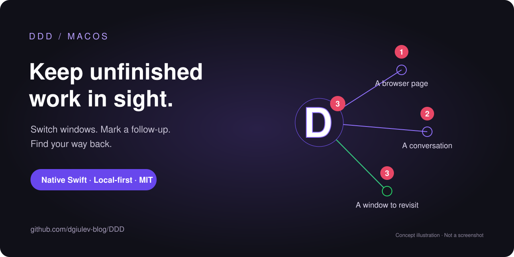

# DDD



**Keep a visible thread back to the work you want to return to.**

DDD is an experimental macOS utility with a floating **D**, a radial app/window picker, and locally saved follow-ups. Middle-click a place in an app to remember it; follow a line or a numbered item back when you are ready.

**v0.1.3 · Experimental · macOS 14+ · MIT-licensed open source**

## What it does

- **Switch visually.** Click the D to see app bubbles, then pick a window. A single window opens directly; minimized windows can be restored.
- **Remember a place.** Middle-click to toggle a follow-up captured from the app's accessibility information: a title, URL, or selected item where available.
- **Return to an Orca workspace.** Orca jobs retain the specific project/workspace rather than only activating Orca. Re-mark old generic Orca jobs to add this context.
- **See every linked job.** Hover over D for a numbered, scrollable list with app names and job labels. Each job has a separate box: left-click to reopen it, right-click to remove its follow-up/link.
- **Keep it in sight.** Numbered follow-ups appear in the picker and count badge. Lines lead toward a matching window or Dock item; clickable endpoint rings reopen the follow-up.
- **Notice possible attention signals.** Green links and pulsing rings reflect Dock badges or dialogs—not task completion or a reliable indication that a response is ready.
- **Optional extras.** Browser window pills can use sampled toolbar colors with Screen Recording permission. If a supported local Tailscale CLI is installed, Screen Sharing lists peers and opens `vnc://` links.

Reopening is **best effort**, using titles, accessibility elements, and selected deep links. DDD is not an exact session-restoration tool.

## Download and start

1. Visit [GitHub Releases](https://github.com/dgiulev-blog/DDD/releases). Download **v0.1.3**, a universal **Apple Silicon + Intel** experimental build. Read its release notes first. Automated core and native UI-construction checks ran on Apple Silicon; end-to-end permission flows and Intel runtime behavior are not release-validated.
2. Download the ZIP and `SHA256SUMS.txt`, and [verify the checksum](docs/USER-GUIDE.md#verify-a-download).
3. **Quit any old DDD**, unzip the download, and drag `DDD.app` into **Applications**. Open it from there.
4. Allow DDD under **System Settings → Privacy & Security → Accessibility**. Screen Recording is optional and only needed for browser colors.
5. Click the floating D, pick an app, and choose a window. Try marking a non-sensitive page with a middle-button mouse click.

**Signing:** the release is ad-hoc signed, not signed with a valid Developer ID, and not notarized. Gatekeeper may block it. For a trusted, verified download, use **System Settings → Privacy & Security → Open Anyway** only if macOS offers it; otherwise build from source. Do not disable system-wide security protections. A checksum detects differences from the published file; it does not prove publisher identity.

> **Important:** while DDD's mouse monitor is active, it intercepts middle-clicks **system-wide**, including when **Show D** is off. Quit DDD to restore native middle-click behavior. The app attempts to enable **Open at Login** on first launch; disable it in the menu if unwanted. Right-clicking an **app bubble requests that app quit**; right-clicking a window pill closes that window, while right-clicking a follow-up pill removes the follow-up.

## Build from source

Use a Mac with Apple's command-line developer tools and a macOS SDK supporting the APIs used here. From the repository root:

```sh
./build.sh                         # build only; does not launch DDD
ARCHS='arm64 x86_64' ./build.sh     # universal build
./scripts/package.sh              # release archive and checksums
```

Packaging produces `dist/DDD-0.1.3-macos-universal.zip` and `dist/SHA256SUMS.txt`. A universal binary is not evidence of Intel runtime testing. See [distribution and release verification](docs/DISTRIBUTION.md) for the packaging and signing process.

## Before you rely on it

Follow-ups are **local plaintext** in `~/Library/Application Support/DDD/followups.json`; titles, URLs, and chat selections may be sensitive. Preferences use the `io.prim.ddd` UserDefaults domain. There is no bundled user data, analytics, or cloud backend. See [Privacy](docs/PRIVACY.md) for system-app and network boundaries.

The picker is mouse-oriented: **Escape dismisses it; there is no global keyboard shortcut**. Lists are capped at two columns and may omit later items. The app uses private `_AXUIElementGetWindow` SPI and is **not App Store-ready**.

## Documentation

- [User guide: walkthrough, troubleshooting, backup and uninstall](docs/USER-GUIDE.md)
- [Privacy and local data](docs/PRIVACY.md)
- [Architecture and implementation limitations](docs/ARCHITECTURE.md)
- [Changelog](CHANGELOG.md) · [Contributing](CONTRIBUTING.md) · [Security](SECURITY.md)
- [Testing and validation scope](docs/TESTING.md) · [Distribution](docs/DISTRIBUTION.md)
- [Repository announcement](docs/ANNOUNCEMENT.md)

## License

DDD is open source under the [MIT License](LICENSE). Copyright Dimitar Giulev. See the license for its permissions and warranty disclaimer.
